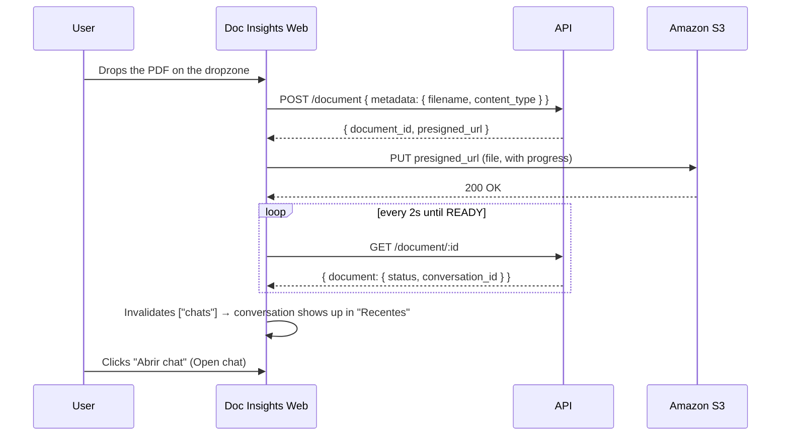
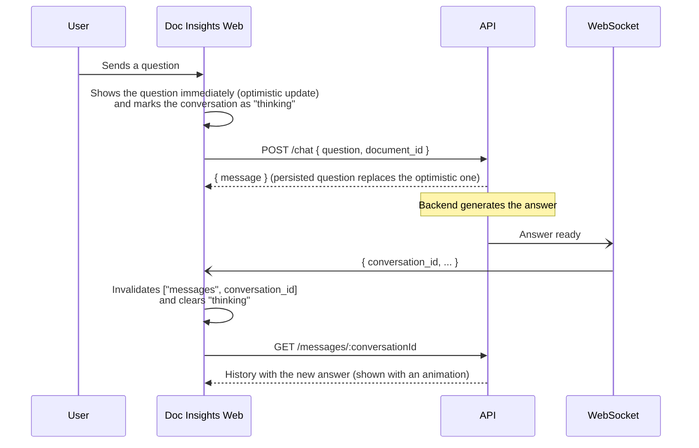

# Doc Insights Web

Frontend for **Doc Insights**: a web application for chatting with your PDF documents. You upload a file, the backend processes its content and, once it is ready, a chat opens where you ask questions in natural language and get answers based on what the document actually says.

---

## What problem it solves

Finding a specific piece of information in a long PDF (a contract, report, manual, paper) usually means reading the whole thing or relying on keyword searches that don't understand context. Doc Insights replaces that process with a conversation:

- **Instead of reading 80 pages**, you ask "what is the termination notice period?" and get the answer.
- **Each conversation is tied to one document**, so answers come from that file's content, not from generic knowledge.
- **History is saved**: conversations show up under "Recentes" (Recent) in the sidebar and can be resumed later.

This repository is only the interface. Text extraction, indexing and answer generation happen in the Doc Insights backend, which this app consumes over HTTP and WebSocket.

---

## Architecture overview

```text
┌──────────────────────────── Doc Insights Web (this repo) ────────────────────────────┐
│                                                                                       │
│  React components ──► Hooks (TanStack Query / Zustand) ──► Services (Axios)           │
│         ▲                         ▲                              │                    │
│         │                         │                              ▼                    │
│   AuthProvider             WebSocketProvider ◄────────  events ── WebSocket           │
│   (token + user)           ("thinking" state)                                         │
└───────────────────────────────────────┬───────────────────────────────┬───────────────┘
                                        │ HTTP (Bearer token)           │ Direct PUT
                                        ▼                               ▼
                              Doc Insights API               Amazon S3 (AWS)
                              (auth, documents,              (presigned URL)
                               conversations, chat)
```

| Layer | Folder | Responsibility |
|---|---|---|
| **Services** | `src/services/` | The only classes that talk to the backend. They build requests and map the API's `snake_case` to the app's `camelCase`. |
| **Data hooks** | `src/hooks/queries`, `src/hooks/mutations` | Wrap the services with TanStack Query (caching, refetching, polling, optimistic updates). |
| **Upload store** | `src/store/uploads.ts` | Upload queue in Zustand + Immer: progress, cancellation, retry. |
| **Contexts** | `src/contexts/` | `AuthProvider` (session) and `WebSocketProvider` (real-time events). |
| **Components** | `src/components/` | Screens and UI. They never call the API directly; they use the hooks. |

---

## Backend integrations

All HTTP calls go through a single Axios client (`src/services/Service.ts`) whose `baseURL` comes from `VITE_DOC_INSIGHTS_API`. After login, the token is attached to every request as `Authorization: Bearer <token>`.

### Endpoint summary

| Method | Route | Service | Used for |
|---|---|---|---|
| `POST` | `/signup` | `AuthService.signUp` | Create an account |
| `POST` | `/signin` | `AuthService.signIn` | Log in |
| `GET` | `/me` | `AccountService.getUser` | Fetch the logged-in user |
| `POST` | `/document` | `DocumentService.createDocument` | Register a document and get an upload URL |
| `PUT` | *S3 presigned URL* | `DocumentService.putObject` | Upload the file directly to Amazon S3 |
| `GET` | `/document/:id` | `DocumentService.getDocumentById` | Track document processing |
| `DELETE` | `/document/:id` | `DocumentService.deleteDocument` | Discard a cancelled or failed document |
| `GET` | `/conversations` | `ChatService.listUserChats` | List recent conversations |
| `GET` | `/conversation/:id` | `ChatService.getChatById` | Conversation details (includes `document_id`) |
| `GET` | `/messages/:conversationId` | `ChatService.getChatMessages` | Message history |
| `POST` | `/chat` | `ChatService.sendMessage` | Send a question |
| `WS` | `VITE_WEBSCOKET_END_POINT?token=` | `WebSocketProvider` | Notification that an answer is ready |

### 1. Authentication

**Files:** `services/AuthService.ts`, `services/AccountService.ts`, `contexts/auth/AuthProvider.tsx`, `lib/AuthTokenManager.ts`, `hooks/queries/useUser.ts`

```text
POST /signin   { email, password }          → { accessToken }
POST /signup   { name, email, password }    → { accessToken }
GET  /me       (Bearer token)               → { user: { id, name, email } }
```

How it works:

1. Login or sign-up returns an `accessToken`.
2. The token is applied to the Axios client **before** state is updated, so the `GET /me` fired right after is already authenticated.
3. The token is persisted by `AuthTokensManager` (AsyncStorage, which uses `localStorage` in the browser) under the key `@auth::user::isLogged`.
4. When the app is reopened, the token is read from storage and `/me` is called. Meanwhile a **splash screen** is shown instead of flashing the login screen.
5. The user is only considered logged in when **a token exists and `/me` returned a user**.
6. If `/me` responds with `401`/`403` (expired or invalid token), the request is not retried and the app falls back to the login screen.
7. Logout clears the stored token, removes the Axios header, drops the cached user and empties the upload queue.

Protected routes (`/` and `/chat/:chatId`) sit behind `PrivateRoute`; `/login` and `/register` sit behind `PublicRoute`, which redirects users who are already logged in.

### 2. Document upload and processing

**Files:** `services/DocumentService.ts`, `store/uploads.ts`, `hooks/queries/useDocument.ts`, `components/upload/*`

The file **never goes through the API**: the API only issues an **Amazon S3** *presigned URL*, and the browser uploads the PDF straight to the bucket. This keeps upload traffic off the application server, and since the URL expires, the browser never receives AWS credentials.



Details:

- **PDF only**, one file at a time (`react-dropzone` with `accept: application/pdf`).
- **Real progress**: Axios `onUploadProgress` updates the uploaded bytes; the dropzone shows a progress ring with the combined percentage of in-flight uploads.
- **Cancellation**: each upload has an `AbortController`. Cancelling aborts the `PUT` and, if the document was already registered, calls `DELETE /document/:id`.
- **Retry**: failed or cancelled uploads can be resent, running the whole flow again.
- **Processing status** (`GET /document/:id`), polled every 2 seconds:

  | Status | Meaning in the UI |
  |---|---|
  | `UPLOADING` | File is being uploaded to S3 |
  | `EXTRACTING` / `EXTRACTED` | Backend is extracting the PDF's text |
  | `INDEXING` | Backend is preparing the content for queries |
  | `READY` | Done: the backend created a conversation (`conversation_id`) |
  | `FAILED` | Processing failed |

  Polling stops when the status is `READY` **and** a `conversation_id` exists. At that point the conversation list is invalidated and the "Abrir chat" (Open chat) button appears.

> The upload queue lives only in memory (Zustand). Reloading the page clears the displayed list, but documents already uploaded remain in the backend and their conversations stay under "Recentes".

### 3. Conversations and messages

**Files:** `services/ChatService.ts`, `hooks/queries/useChats.ts`, `hooks/queries/useChat.ts`, `hooks/queries/useMessages.ts`, `hooks/mutations/useQuestion.ts`, `components/chat/*`, `components/message/*`

```text
GET  /conversations              → { conversations: Chat[] }
GET  /conversation/:id           → { conversation: { id, name, document_id, user_id, created_at } }
GET  /messages/:conversationId   → { messages: [{ id, content, conversation_id, message_type, created_at }] }
POST /chat  { question, document_id } → { message: {...} }
```

`message_type` is either `QUESTION` (the user's question) or `ANSWER` (the generated answer). The app also uses `WAITING-RESPONSE` locally for the "Buscando respostas..." (Searching for answers...) bubble.

TanStack Query cache keys:

| Key | Content |
|---|---|
| `["user", token]` | Logged-in user |
| `["chats"]` | Sidebar conversation list |
| `["chat", chatId]` | Conversation details (source of the `documentId` sent in `POST /chat`) |
| `["messages", chatId]` | Conversation history |
| `["document", documentId]` | Processing status of an upload |

### 4. Real time (WebSocket)

**Files:** `contexts/webscoket/WebSocketProvider.tsx`, `contexts/webscoket/index.ts`

Answer generation is asynchronous on the backend. `POST /chat` only registers the question; the answer arrives later, and the WebSocket signals when it is ready.



Connection behavior:

- Opened only for logged-in users, at `VITE_WEBSCOKET_END_POINT?token=<accessToken>`. The token goes in the query string because the browser WebSocket API does not allow custom headers.
- **The answer content does not come through the socket.** The event only says which `conversation_id` changed; the app then refetches the messages over HTTP. This keeps HTTP as the single source of truth.
- **Automatic reconnection** with exponential backoff: 1s, 2s, 4s… up to a 30s cap, reset after a successful connection.
- The per-conversation `isThinkingChats` state blocks sending another question while an answer is pending in that chat.

---

## Folder structure

```text
src/
├── app.tsx                  # Routes + PrivateRoute/PublicRoute
├── main.tsx                 # Entry point
├── index.css                # Tailwind, font, focus styles, reduced motion
├── components/
│   ├── button/ input/       # Base components
│   ├── chat/                # Chat screen and question input
│   ├── message/             # Message list and bubbles
│   ├── layouts/             # AppLayout, sidebar, mobile menu, AuthLayout
│   ├── signin/ signup/      # Authentication screens
│   ├── upload/              # Dropzone, upload queue and items
│   └── ui/                  # SplashScreen, CircularProgressBar
├── config/env.ts            # Reads and validates (Zod) environment variables
├── contexts/
│   ├── auth/                # Session: token, user, signIn/signUp/signOut
│   └── webscoket/           # WebSocket connection and "thinking" state
├── hooks/
│   ├── queries/             # useUser, useChats, useChat, useMessages, useDocument
│   └── mutations/           # useQuestion
├── lib/AuthTokenManager.ts  # Token persistence
├── services/                # HTTP clients per domain
├── store/uploads.ts         # Upload queue (Zustand + Immer)
├── types/                   # Shared types
└── utils/cn.ts              # clsx + tailwind-merge
```

---

## Stack

- **React 19** + **TypeScript** + **Vite**
- **React Router DOM**: routing and page protection
- **TanStack Query**: caching and syncing backend data
- **Zustand** + **Immer**: upload queue
- **Axios**: HTTP client
- **React Hook Form** + **Zod**: forms and validation (including environment variables)
- **Tailwind CSS v4**, **Radix UI** (Collapsible, ScrollArea), **Motion** (animations) and **Lucide** (icons)

---

## Getting started

### Requirements

- Node.js 18+
- npm
- A reachable Doc Insights backend (HTTP API + WebSocket)

### Environment variables

Create a `.env` file in the project root:

```env
VITE_DOC_INSIGHTS_API="https://<api-url>"
VITE_WEBSCOKET_END_POINT="wss://<websocket-url>"
```

| Variable | Purpose |
|---|---|
| `VITE_DOC_INSIGHTS_API` | Base URL for all HTTP calls |
| `VITE_WEBSCOKET_END_POINT` | WebSocket endpoint for chat events |

Both are validated with Zod in `src/config/env.ts`; if either is missing or not a valid URL, the app fails on startup.

### Commands

```bash
npm install       # install dependencies
npm run dev       # development server at http://localhost:5173
npm run build     # type-check + production build
npm run preview   # serve the production build locally
npm run lint      # ESLint
```

---

## Known limitations

- **No refresh token**: when the token expires, the user has to log in again.
- **Token in `localStorage`**: simple, but readable by any script on the page. For more sensitive production use, consider `httpOnly` cookies.
- **One PDF at a time**, with no file size limit enforced on the frontend.
- **The upload queue does not persist** across page reloads.
- **Document polling** every 2s; it could be replaced by events on the same WebSocket used by the chat.

## License

This project does not currently define an explicit license.
